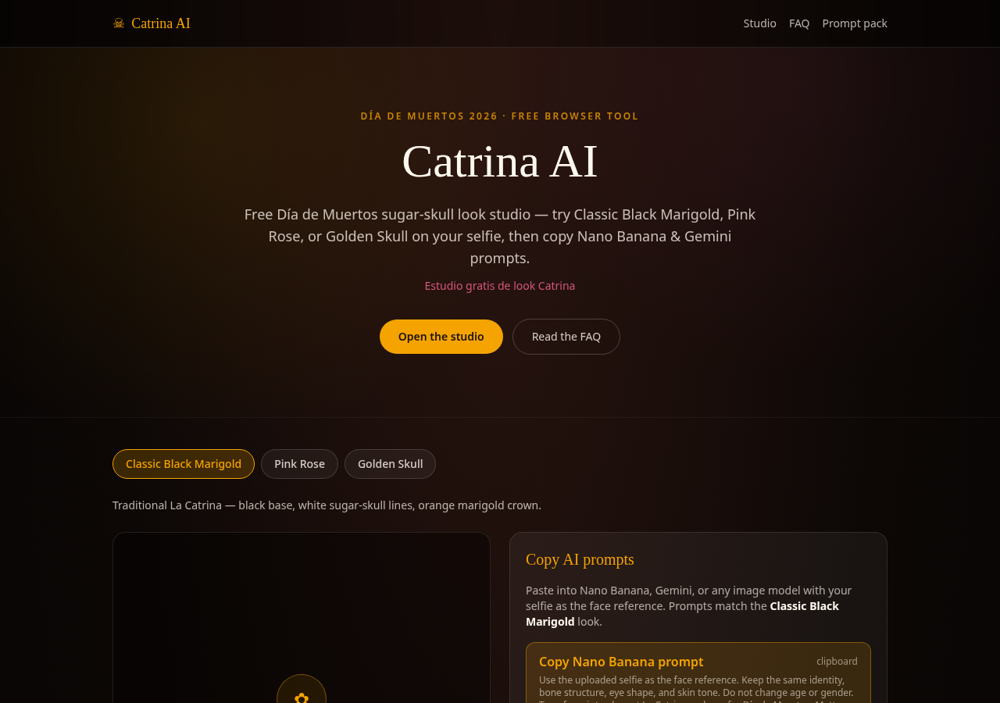

# Catrina Studio

[](https://github.com/hukaixuan/catrina-studio/actions/workflows/ci.yml)
[](LICENSE)

A free, fully client-side **Día de Muertos (La Catrina) look studio**. Upload a selfie, preview a sugar-skull overlay drawn with the Canvas API, and copy matching prompts for image models.

**Live demo:** https://catrina-ai-1.vercel.app



## Features

- Three looks: Classic Black Marigold, Pink Rose, Golden Skull
- Procedural overlay (eye sockets, heart nose, filigree, smile lines, flower crown) drawn on `<canvas>`
- Copy-ready prompts for Nano Banana / Gemini image models that keep your face as the reference
- Download the preview as a PNG
- Privacy by design: your photo never leaves the browser; no backend, no API keys

## Quickstart

Requires Node.js 20.19+ (22 or 24 recommended).

```bash
git clone https://github.com/hukaixuan/catrina-studio.git
cd catrina-studio
npm ci
npm run dev        # http://localhost:5173
```

Other scripts: `npm run typecheck`, `npm run lint`, `npm run build`, `npm run preview`.

## How it works

| File | Role |
| --- | --- |
| `src/presets.ts` | The three looks: color palettes and image-model prompts |
| `src/drawOverlay.ts` | Canvas drawing for each face-paint element |
| `src/components/Studio.tsx` | Upload, preview, prompt copy, and download UI |

Stack: Vite, React 19, TypeScript, Tailwind CSS v4, oxlint.

## Cultural note

La Catrina and Día de Muertos are meaningful traditions. The looks and prompts aim to be respectful (no horror or gore). Feedback from people who celebrate is very welcome.

## Roadmap

- [ ] Face-landmark alignment so overlays follow the face instead of a fixed layout
- [ ] More looks, contributed as presets
- [ ] Spanish UI translation
- [ ] Unit tests for preset data and color helpers

## Contributing

See [CONTRIBUTING.md](CONTRIBUTING.md).

## License

[MIT](LICENSE) © 2026 Hu Kaixuan

Unofficial fan tool, not affiliated with any AI vendor. The hosted demo also links to an optional paid prompt pack by the author; that pack is not part of this repository.
